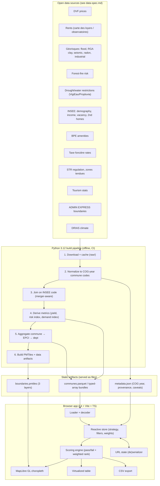

# Land Screener FR — Architecture & Tech Plan

> **Status:** Draft v0.1
> **Scope:** This document is the architecture and technical plan. Dataset
> sourcing, legal licensing, exact URLs, and update frequency per dataset are
> owned by a parallel document, `docs/data-spec.md`. This file references data
> *themes* and treats the data-spec as the authority on *what* and *from where*;
> it owns *how the data flows and how the app is built*.

> **Reference tool note:** The US tool "High Ground"
> ([land_screener](https://land-screener-nu.vercel.app/land_screener),
> [user_guide](https://land-screener-nu.vercel.app/user_guide),
> [tax_rankings](https://land-screener-nu.vercel.app/tax_rankings)) is the UX
> pattern we follow. **These pages could not be fetched from the build
> environment (host network could not reach the vercel.app domain — `curl`
> returned `000`, playwright returned `chrome-error://`).** The reference
> behaviour below is therefore reconstructed from the project brief's
> description, not from a live read, and every reference claim is marked
> **(per brief, to verify against live site)**.

---

## 1. Product summary

A **static, client-side** web app that helps a user decide **where in France to
buy land or property to rent out**. The user picks a **rental strategy**, and the
filters, weights, and scoring presets adapt to that strategy:

| Strategy | Horizon | Demand driver | Example target |
|---|---|---|---|
| **Short-term** | Nightly/weekly | Tourism, seasonality | Coastal/mountain/heritage communes, high ADR, strong season |
| **Medium-term** | Weeks–months | Students, professional mobility, seasonal workers | University towns, hospital/industrial hubs, ski resorts off-season |
| **Long-term** | 1 year+ | Resident households | Commuter belts, stable employment, population growth |

The analytical **spine** is always the same question: *where does the
rent/price math work, under acceptable risk, with the right rental demand?* Each
strategy reweights the three pillars (**yield**, **risk**, **demand**) and swaps
in strategy-specific demand signals.

### Reference behaviour we are mirroring (per brief, to verify against live site)

- Client-side only, no server; everything recalculates in the browser.
- **Filter groups decide pass/fail** (a candidate either survives all active
  filters or is excluded).
- **Weights only order** the ranked table among survivors — they never exclude.
- Tier-colored choropleth map.
- Sortable results table.
- CSV export of the current result set.
- URL/state is shareable.

We keep all of this and add: **per-strategy presets**, a **3-level geographic
hierarchy** (commune → EPCI → département), and **French-specific risk and
regulation themes**.

---

## 2. System overview



**Two halves that never run at the same time:**

1. **Build-time (Python, offline/CI):** heavy ETL that turns dozens of messy
   open datasets into a handful of small, typed, versioned static files.
2. **Run-time (browser, no server):** load those files once, then every filter
   change / weight change / strategy switch is pure in-browser recomputation.

The contract between the two is the **artifact schema** (§5). The browser never
talks to a data API; it only fetches static files from the CDN.

---

## 3. Data pipeline (Python 3.12)

Tooling: **Polars** for columnar transforms and **DuckDB** for ad-hoc SQL joins
over large files; both read/write Parquet natively. **Tippecanoe** (or
`pmtiles` + `ogr2ogr`) builds the vector tiles.

### Stage 1 — Download & cache
- Each source has a small fetcher writing to `raw/<theme>/<cog_year>/`.
- Content-addressed cache: record source URL, fetch timestamp, SHA-256, and
  published/vintage date into `provenance.jsonl`. A re-run with an unchanged
  hash is a no-op.
- Fetchers are **idempotent and resumable**; large files stream to disk.
- Licensing and exact endpoints: **owned by `data-spec.md`**.

### Stage 2 — Normalize to a single COG year
The single hardest correctness problem is that the commune referential changes
every year (the **COG — Code Officiel Géographique**). Communes merge
(*communes nouvelles*), occasionally split, and codes get reused/retired.

- **Pick one target COG year** (COG 2026 — published by INSEE, see `docs/data-spec.md`) as the canonical referential for
  a given data release; record it in `metadata.json`.
- Build a **commune code crosswalk** from the official COG *mouvements* table
  (`passage` / `fusions` history): `old_code → new_code` with the effective
  year. (Source: INSEE COG movements — *to verify in data-spec.md*.)
- For every incoming dataset, **remap each record's commune code to the target
  COG year** before any join. When a dataset still uses retired codes, apply the
  crosswalk; when a merged commune's components appear separately, aggregate
  additive metrics (counts, transaction volumes) and population-weight the
  intensive ones (prices, rates) — see Stage 4.
- Records that cannot be mapped (foreign, obsolete-unresolvable, Monaco, etc.)
  go to a `rejects/` sink with a reason, never silently dropped.
- **Arrondissements:** Paris/Lyon/Marseille exist both as the "commune" code and
  as arrondissement codes. Decide one canonical level per city (recommend:
  keep arrondissements as the base rows for these three, since rent/price
  varies enormously within them) and document it. **(to verify)**

### Stage 3 — Join on INSEE commune code
- All themes are reduced to **one row per commune** keyed by the 5-char INSEE
  code (not postal code — postal codes are many-to-many with communes).
- DuckDB left-joins each theme table onto the ADMIN EXPRESS commune spine, so
  every commune that has a boundary gets a row even when a theme is missing
  (missingness is explicit, see §5.3).
- Join audit: after each join, assert join-key coverage and log the % of
  communes matched per theme into `join_report.json`.

### Stage 4 — Derive metrics
Per-commune derived fields feeding the three scoring pillars:

- **Yield pillar**
  - `gross_yield = annual_rent_estimate / purchase_price_per_unit`
    - `annual_rent_estimate` from carte des loyers (€/m²/month × 12 × a
      reference surface, or kept per-m² and combined with a per-m² price).
    - `price` from DVF (median €/m² by property type, trailing window).
  - Net-of-tax variant using `taxe_fonciere` rate **(v1+, to verify feasibility
    at commune granularity)**.
- **Risk pillar** (each normalized 0–1, then combined)
  - Flood (PPRI/zones), RGA clay shrink-swell exposure, seismic zone, radon
    potential, nearby industrial/SEVESO, forest-fire risk, drought/water-
    restriction frequency (VigiEau/Propluvia history), DRIAS forward climate
    signal (heat/drought trend). Combination rule documented as a transparent
    weighted max/mean — **not** a black box.
- **Demand pillar** (strategy-dependent raw inputs; see §7.3)
  - Tourism intensity, second-home share, student/university presence,
    employment/mobility, population trend, rental vacancy, amenities (BPE),
    zones tendues flag, STR regulation severity flag.

All intensive metrics (prices, rates, ratios) carry the **vintage year** and the
**sample size / transaction count** so the UI can show confidence and the engine
can optionally gate on minimum sample.

### Stage 5 — Aggregate commune → EPCI → département
- EPCI and département rows are computed from the commune rows using an explicit
  rule table per metric:
  - **Additive** (transaction counts, population): sum.
  - **Intensive** (€/m², yields, rates): **population- or transaction-weighted
    mean**, never a naive mean.
  - **Risk flags:** worst-case or share-of-area-exposed, documented per field.
- The aggregation map (`commune → epci_code`, `commune → dept_code`) comes from
  the COG/ADMIN EXPRESS referential for the same target year.
- Aggregated layers exist so the map can render fast at low zoom and the user can
  drill down; the **scoring engine still scores at the level currently
  displayed**, using that level's row set.

### Stage 6 — Tile & artifact build
- **Boundaries → PMTiles** with three layers (`communes`, `epci`, `departements`),
  each feature carrying only its code + minimal label (no metrics baked into
  tiles — metrics live in the data bundle and are joined client-side by code, so
  we can change scoring without rebuilding tiles).
- Geometry is **simplified per zoom level** (Douglas-Peucker / Visvalingam via
  tippecanoe) with aggressive simplification at low zoom.
- **Metrics → columnar bundle** (§5): one Parquet (or typed-array binary) per
  level, plus a small `metadata.json`.
- A content hash in each artifact filename enables long-cache + instant
  cache-busting on rebuild.

### Pipeline orchestration
- Plain Python with a thin task runner (recommend `make` or `invoke`; **a DAG
  tool like Dagster is optional and overkill for v0, to verify by need**).
- Deterministic: same inputs + same COG year ⇒ byte-identical artifacts
  (sorted rows, fixed float formatting) so diffs are reviewable.

---

## 4. Geographic model

| Level | Count (approx) | Role |
|---|---|---|
| **Commune** | ~34,900 | Base analytical unit; default table rows |
| **EPCI** (intercommunalités) | ~1,250 | Mid-zoom map, drill-down |
| **Département** | ~101 | Low-zoom map overview |

- The **commune is the base unit** for all scoring. EPCI/dept are
  **presentation and navigation aggregates** rebuilt from commune data.
- Zoom thresholds drive which boundary layer is shown; the active scoring level
  follows the visible layer unless the user pins a level.

---

## 5. Artifact formats & size budgets

### 5.1 Target budgets (35k communes)

| Artifact | Format | Rough size target | Notes |
|---|---|---|---|
| `communes.<hash>.parquet` | Parquet (zstd) | **1.5–4 MB** | ~35k rows × ~40 numeric cols; dictionary/ delta encoding |
| `epci.<hash>.parquet` | Parquet | < 300 KB | ~1.25k rows |
| `departements.<hash>.parquet` | Parquet | < 50 KB | ~101 rows |
| `boundaries.<hash>.pmtiles` | PMTiles | **15–40 MB** | 3 layers, zoom-simplified; range-requested, not fully downloaded |
| `metadata.json` | JSON | < 50 KB | COG year, column dictionary, provenance, caveats |

**Design intent:** the full metric table for communes must be small enough to
load eagerly (single-digit MB). PMTiles are **range-requested by the map** (only
visible tiles fetched), so the 15–40 MB figure is on-disk, not download-per-
session.

### 5.2 Decode choice
Two options, decide by benchmark **(to verify)**:
- **Parquet in the browser** via `hyparquet` / DuckDB-Wasm — keeps one format
  end-to-end, best compression, but adds a wasm/decoder dependency.
- **Typed-array binary bundle** (one `ArrayBuffer` per column + a JSON header) —
  zero decode cost, columns map straight to `Float32Array`/`Int32Array` for the
  engine, slightly larger on the wire. **Recommended for v0** for raw speed and
  minimal deps; revisit Parquet if the bundle grows.

### 5.3 Missing-data encoding
- Numeric: sentinel `NaN` (typed arrays) or null (Parquet); the engine treats
  missing as **fail** for a hard filter only if the user opts in, otherwise as
  **unknown** (survives filter, flagged in table). Document the default.
- Per-column coverage % lives in `metadata.json` and is shown in the UI.

---

## 6. Frontend architecture (Lit + Vite + TypeScript)

Stack is **fixed**: Lit (LitElement) + Vite + TypeScript, static output, no
React. Node tooling on this host must use the mise shim path for `npx`/`npm`.

### 6.1 Component tree

```
<app-root>
├── <app-header>            strategy picker, title, lang toggle
├── <strategy-bar>          active strategy + preset chips
├── <control-panel>         (collapsible drawer)
│   ├── <filter-group>*     one per theme; pass/fail controls
│   │   └── <filter-control> range slider / toggle / multiselect
│   └── <weight-panel>      per-pillar + per-signal weight sliders
├── <map-view>              MapLibre GL canvas + tier legend + level switch
│   └── <map-legend>
├── <results-table>         virtualized, sortable, column chooser
│   └── <table-row>         (windowed)
├── <detail-drawer>         single-commune breakdown (metrics, provenance, caveats)
├── <export-bar>            CSV export, share-URL button
└── <provenance-footer>     data vintage, COG year, caveats link
```

`*` repeated. Components are dumb-render + emit events; **no business logic in
components** — they read from the store and dispatch intents.

### 6.2 State model

A single reactive store (recommend a tiny observable store — Lit `@lit/context`
+ signals, or a 50-line custom store; **no Redux**). Shape:

```ts
interface AppState {
  cogYear: number;
  level: 'commune' | 'epci' | 'departement';
  strategy: 'short' | 'medium' | 'long';
  filters: Record<FilterId, FilterSetting>;   // pass/fail definitions
  weights: Record<SignalId, number>;          // ordering only
  map: { center: [number, number]; zoom: number; };
  selection: string | null;                    // selected area code
  sort: { column: ColumnId; dir: 'asc' | 'desc' };
  lang: 'fr' | 'en';
}
```

- **Derived** (never stored, recomputed by the engine): `passSet`, `scores`,
  `tiers`, `rankedRows`, `legendBreaks`.
- Strategy switch loads a **preset** that replaces `filters` + `weights` with
  that strategy's defaults (user edits then diverge from the preset; a "reset to
  preset" affordance restores them).

### 6.3 Scoring / filter engine

Pure TypeScript module, no DOM, fully unit-testable, operating on the typed
column arrays (columnar, cache-friendly).

```
input:  columns (Float32Array per metric), filters, weights, level
step 1  PASS/FAIL  → boolean mask over all rows (AND of active filter groups)
step 2  NORMALIZE  → each weighted signal mapped to 0..1 (direction-aware:
                     higher-is-better vs lower-is-better per signal)
step 3  SCORE      → weighted sum of normalized signals, survivors only
step 4  TIER       → quantile or fixed-break bucketing into color tiers
step 5  RANK       → stable sort by score; emit ranked index array
```

Key invariants (mirroring the reference, per brief):
- **Filters exclude; weights never exclude.** A zero-weight signal still shows
  in the table, it just doesn't move the score.
- Recompute is **O(rows × active signals)** — ~35k × ~15 ≈ sub-millisecond-class
  on typed arrays; runs synchronously on the main thread for v0, with a Web
  Worker fallback if profiling demands it **(to verify by profiling)**.
- Deterministic, side-effect free: same state ⇒ same ranked output (enables
  snapshot tests and URL reproducibility).

### 6.4 Map rendering & performance

- **MapLibre GL JS** + **PMTiles** (via the `pmtiles` protocol plugin), vector
  tiles range-requested from static storage.
- Choropleth: the engine produces `code → tier` and `code → score`; we drive
  the fill color through a **feature-state** join (set `feature-state` by code)
  or a data-join expression, so **re-coloring on filter change does not refetch
  tiles**.
- Only the visible boundary layer for the current zoom is styled; the other two
  layers are hidden, not loaded.
- Legend breaks come from the engine's tiering so map and table always agree.
- Interaction: hover highlight, click → `selection`, which opens the detail
  drawer and highlights the table row.
- Alternative considered: Leaflet + GeoJSON. **Rejected** — 35k polygons as
  GeoJSON is too heavy for the browser and re-styling is slow; MapLibre + vector
  tiles + feature-state is the right tool. (This is the justified default the
  brief asked for; no alternative proposed.)

### 6.5 Table virtualization
- Windowed rendering (e.g. `@lit-labs/virtualizer` or a hand-rolled windower)
  so only visible rows mount — 35k rows must never all be in the DOM.
- Sort is delegated to the engine's ranked index (re-sort = re-slice, no DOM
  rebuild).
- Column chooser lets the user add/remove metric columns; CSV export mirrors the
  visible columns + always-included identity columns.

### 6.6 CSV export
- Pure client-side: serialize the **current result set** (post-filter,
  current sort, chosen columns) to CSV, `Blob` + object URL download.
- UTF-8 BOM prepended so Excel on French locales reads accents correctly;
  decimal/separator convention documented (recommend `.` decimal + `,` field,
  or offer a `;`-separated FR variant **(to verify preference)**).
- Include a header row with human-readable (localized) column names and a
  trailing provenance comment line (vintage, COG year).

### 6.7 URL-shareable state
- Serialize strategy + level + filters + weights + map view + sort + lang into a
  compact, versioned query/hash string (short keys; bitpack or base64 the filter
  block if it gets long). A schema-version prefix lets old links degrade
  gracefully.
- On load, hydrate the store from the URL before first paint; thereafter push
  (debounced) `history.replaceState` so the address bar is always a shareable
  snapshot. The "share" button copies the current URL.
- Selection is included so a shared link can deep-link to one commune's drawer.

### 6.8 i18n (French / English)
- Lightweight message catalogs (`fr.json`, `en.json`); default **fr**.
- Localize: UI chrome, metric/column display names, tier labels, strategy names,
  caveat text, and **number/currency formatting** via `Intl.NumberFormat`
  (`fr-FR` vs `en`). Data values stay numeric; only presentation is localized.
- Language is part of URL state so shared links keep the sender's language or
  can be switched by the recipient.

---

## 7. Strategies, filters, weights

### 7.1 Pass/fail filters (examples, non-exhaustive, to verify thresholds)
Per theme, user-adjustable; defaults come from the active strategy preset:
- Min gross yield; max €/m²; max flood/RGA/seismic/fire risk tier; max
  drought-restriction frequency; min population / min transaction sample;
  exclude communes under STR regulation (for short-term); zones-tendues toggle.

### 7.2 Weights (ordering only)
- Three pillar weights (yield / risk / demand) plus per-signal weights inside
  each pillar. Weights normalize to 1 internally; a weight of 0 removes a
  signal's influence but not the row.

### 7.3 Per-strategy presets (illustrative, to verify)

| Pillar / signal | Short-term | Medium-term | Long-term |
|---|---|---|---|
| Tourism intensity | high weight | low | off |
| Second-home share | medium | low | off (can be negative signal) |
| Student/university presence | off | high | low |
| Employment/mobility hubs | low | high | medium |
| Population trend | low | medium | high |
| Rental vacancy (low = good) | medium | high | high |
| STR regulation severity | hard filter | soft | off |
| Yield weight | high | high | medium |
| Risk weight | medium | medium | high |

Presets are data (a JSON file in the app bundle), not code, so they can be
tuned without a rebuild of logic.

---

## 8. Hosting & delivery

- **Fully static**: build to `dist/`, deploy to any static host.
  Recommended: **Vercel** or **GitHub Pages** for v0 (zero cost, simple);
  **S3 + CloudFront** when custom caching/headers or scale matter.
- Requirements the host must satisfy:
  - **HTTP range requests** (needed for PMTiles partial fetch) — all three
    options support this.
  - Long-cache immutable assets (content-hashed filenames) + short-cache
    `metadata.json`/`index.html`.
  - CORS not an issue (same-origin static files).
- No backend, no secrets, no runtime compute — the only moving part is the
  periodic pipeline that regenerates and re-uploads artifacts.

---

## 9. Data refresh cadence & provenance display

- **Cadence is per-theme** and owned by `data-spec.md` (DVF ~biannual, rents
  ~annual, risk layers irregular, etc.). The pipeline is run on demand / on a
  schedule; a release bumps the artifact hashes and `metadata.json`.
- **Provenance is first-class in the UI**: a footer + per-metric tooltip shows
  source, vintage year, COG year, and sample size; a caveats panel explains
  estimate limits (e.g. carte des loyers is a *model*, DVF excludes some sale
  types, risk tiers are regulatory not probabilistic). Every number the user
  acts on can be traced to its vintage and caveat. **(exact copy to verify)**

---

## 10. Testing strategy

| Layer | Tooling | What it covers |
|---|---|---|
| **Pipeline unit** | pytest | COG crosswalk remap (mergers/splits/retired codes), join coverage assertions, aggregation rules (weighted vs additive), derived-metric formulas, reject-sink reasons |
| **Pipeline golden** | pytest + small fixtures | Deterministic artifact output (hash-stable) on a tiny synthetic COG set |
| **Scoring engine** | Vitest | Pass/fail masking, direction-aware normalization, weight=0 keeps rows, tiering breaks, stable sort, missing-data policy |
| **State/URL** | Vitest | URL (de)serialize round-trip, schema-version fallback, preset application |
| **Component** | Vitest + `@open-wc/testing` | Lit components render from state, emit correct intents |
| **E2E** | Playwright | Load → pick strategy → adjust filter → map re-colors → table re-ranks → CSV downloads → shared URL reproduces state; i18n toggle |

- E2E runs against the built static site with a **fixture artifact set** (a few
  hundred communes) so tests are fast and deterministic.
- CI gates: typecheck, lint, Vitest, pipeline pytest, Playwright, production
  build.

---

## 11. Repository layout

```
land-screener-fr/
├── docs/
│   ├── architecture.md          (this file)
│   └── data-spec.md             (datasets, sources, licensing — parallel task)
├── pipeline/                     Python 3.12
│   ├── pyproject.toml
│   ├── fetchers/                 one module per theme
│   ├── normalize/                COG crosswalk, code remap
│   ├── transform/                joins, derived metrics (Polars/DuckDB)
│   ├── aggregate/                commune→epci→dept rules
│   ├── tiles/                    PMTiles / tippecanoe build
│   ├── artifacts/                parquet / typed-array writers, metadata.json
│   ├── tasks.py (or Makefile)    orchestration
│   └── tests/
├── web/                          Lit + Vite + TS
│   ├── index.html
│   ├── vite.config.ts
│   ├── src/
│   │   ├── components/           Lit elements (§6.1)
│   │   ├── store/                reactive state (§6.2)
│   │   ├── engine/               scoring/filter engine (§6.3)
│   │   ├── map/                  MapLibre + PMTiles glue (§6.4)
│   │   ├── data/                 artifact loader/decoder
│   │   ├── strategies/           preset JSON + types (§7.3)
│   │   ├── i18n/                 fr.json / en.json
│   │   ├── url/                  state (de)serializer (§6.7)
│   │   └── export/               CSV (§6.6)
│   └── tests/ (Vitest) + e2e/ (Playwright)
├── artifacts/                    build output (gitignored; produced by pipeline)
│   ├── communes.<hash>.parquet
│   ├── epci.<hash>.parquet
│   ├── departements.<hash>.parquet
│   ├── boundaries.<hash>.pmtiles
│   └── metadata.json
└── raw/                          downloaded sources (gitignored, cached)
```

Pipeline and web are independent packages sharing only the **artifact schema**
(a generated TS type from `metadata.json`'s column dictionary keeps them in
sync — recommended **(to verify)**).

---

## 12. Phased roadmap

### v0 — Prototype (prove the loop)
- One strategy (**long-term**), one level (**commune**), ~1–3 regions of data.
- Themes: DVF price, carte des loyers rent, 1–2 risk layers, INSEE population.
- Typed-array artifact bundle; MapLibre + PMTiles choropleth; sortable virtual
  table; basic pass/fail + weighted rank engine; CSV export; URL state.
- Goal: demonstrate load → filter → re-color → re-rank → export end-to-end on a
  real subset.

### v1 — National, three strategies
- All ~34,900 communes + EPCI + département layers.
- All three strategies with presets; full filter/weight panel.
- Full risk pillar (flood, RGA, seismic, radon, fire, drought, industrial).
- Full demand pillar signals; STR regulation + zones tendues filters.
- i18n fr/en; provenance/caveats UI; detail drawer with per-commune breakdown.
- Complete test suite + Playwright e2e + CI.

### Later
- Net-of-tax yield using taxe foncière; DRIAS forward-climate risk signal.
- Confidence/sample-size gating and uncertainty display.
- Saved screens / comparison of multiple shared URLs.
- Parquet-in-browser (DuckDB-Wasm) if the typed-array bundle outgrows eager load.
- Optional Web Worker engine if profiling shows main-thread jank.
- Arrondissement-level refinement for Paris/Lyon/Marseille.

---

## 13. Open questions / to verify
- Live reference-tool behaviour (could not fetch during this write; §1).
- Decode format: typed-array bundle vs Parquet-in-browser (benchmark).
- Exact COG target year + arrondissement handling for PLM cities.
- Commune-level availability of taxe foncière rates and rent model granularity.
- Whether a Web Worker is needed for the engine at national scale.
- CSV separator convention for French Excel users.
- Dagster/DAG orchestration vs a simple Makefile for the pipeline.
